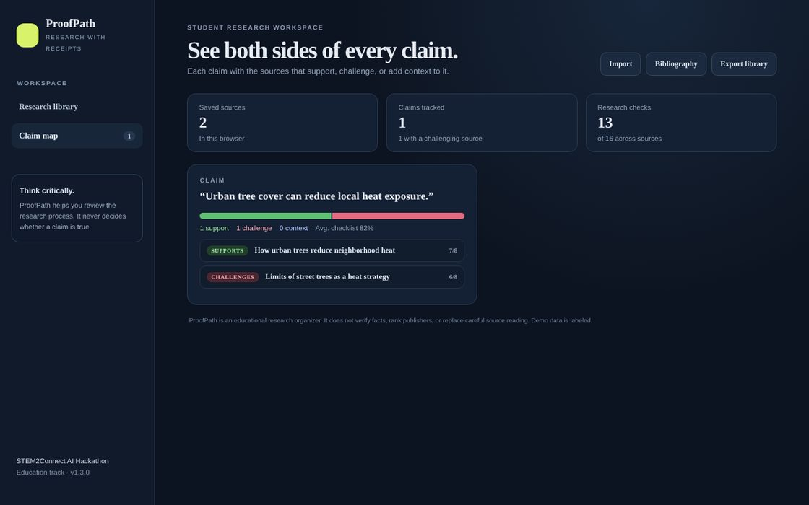

# ProofPath — version 1.3.0

**Research with receipts.** ProofPath is a student research workspace that helps learners organize sources, write down claims, and review the evidence trail behind an argument.



## My role & contributions

**Solo developer · AI-assisted**

- Designed the 8-point evidence checklist and the claim map
- Found and fixed a checklist bug where unchecking a box wrote "false" into the field

## Why it exists
Students often collect links without tracking who created them, when they were published, what methods they used, or whether independent sources support the same claim. ProofPath turns those habits into a visible checklist.

## Features in V1
- Add and search a local research library.
- Record source title, URL, author, publisher, date, and a specific claim.
- Review an eight-point evidence checklist.
- See a transparent research-process completion indicator.
- Get practical gap suggestions from a local fallback coach.
- Optional OpenAI-compatible AI coach when configured by the operator.
- Export the research library as JSON.
- Responsive interface and Node built-in tests.

## Important limitation
The checklist is **not** a truth score, fact-check, or publisher ranking. A source can pass every checklist item and still be wrong. Students must read original sources and verify whether evidence supports the claim. The included source is fictional demo data.

## Run locally
Requires Node.js 20.19+ (or Node.js 22+).

```bash
npm install
npm run dev
```

In a second terminal, start the optional coach API:

```bash
npm run server
```

To enable the external AI coach, copy `.env.example` to `.env` and set `AI_API_KEY`. The server loads `.env` itself. Without a key, the local checklist coach is used.

Open `http://localhost:5173`.

Run tests and syntax checks:

```bash
npm test
npm run check
```

Build:

```bash
npm run build
```

## Input validation and API safety

Source fields are normalized and bounded. Only HTTP and HTTPS links are accepted as source URLs. The optional coach API checks request content type and JSON, limits request size, uses a timeout for the external provider, and bounds returned text. The API remains a local prototype, not a production-hosted service.

## Optional AI coach
Copy `.env.example` to `.env`, add an API key for a compatible chat-completions endpoint, and set `AI_BASE_URL` and `AI_MODEL` if needed. Restart the server. Never commit `.env` or expose API keys in frontend code. Without credentials, the local checklist coach still works.

## Data and privacy
V1 stores the research library in the browser's local storage. Export creates a JSON file. Do not enter private, sensitive, or personally identifying information. No user account or remote database is included.

## Technology
React, Vite, plain CSS, Node.js built-in HTTP server, and Node's built-in test runner.

## AI disclosure template
This project was developed with AI assistance. Before submitting, replace this paragraph with the actual tools used, what work they contributed, and which features are AI-powered. The optional AI coach calls a configured OpenAI-compatible API; without configuration, it uses deterministic local checklist logic. Do not claim an AI integration was active in the demo unless it was.

## Third-party assets
Lucide React icons and Google Fonts are used. Verify current licenses and disclose them in the final Devpost entry. The demo source record is fictional and uses an example.edu URL.

## Verification status

The Node test suite passes (7/7), including a local API integration test. A Vite production build still needs a fresh dependency install on the target platform; the development workspace could not use the platform-specific Vite native binding from the reference project archive.

See `docs/QA_AND_PRIVACY.md` and `docs/DEMO_SCRIPT.md`.

## License
Permission required: see [License](#license) and `LICENSE`.
